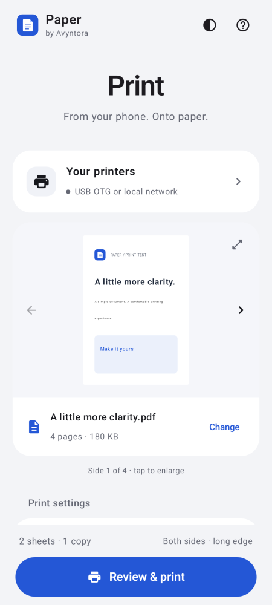
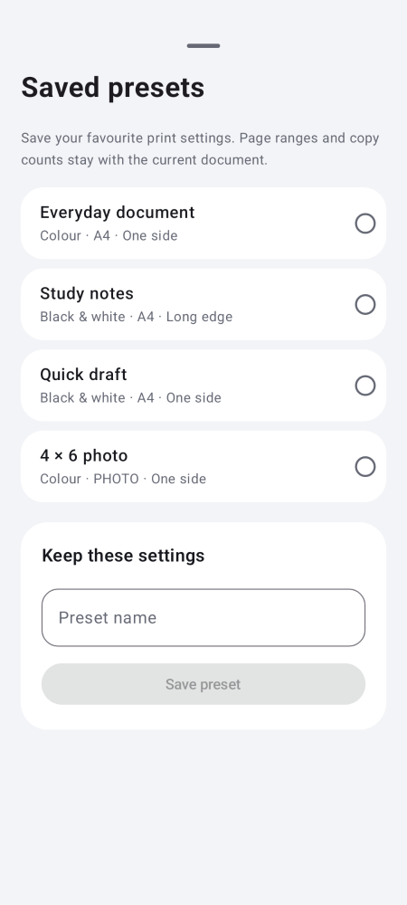
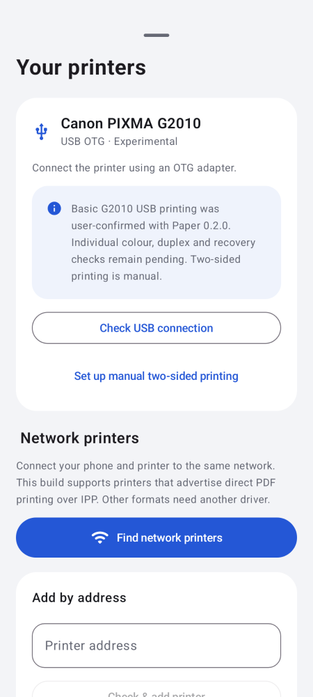

# Paper by Avyntora

**Paper is a product of Avyntora.** Free and open-source printing for Android: print PDFs, photos and text through USB OTG or compatible IPP/IPPS network printers. No ads, accounts or analytics.

[Download the development APK](https://github.com/klpmaleesha/Paper/releases/tag/v0.3.0) · [Printer compatibility](COMPATIBILITY.md) · [Privacy](PRIVACY.md) · [Contributing](CONTRIBUTING.md)

Native Kotlin and Jetpack Compose, with a one-handed interface influenced by Samsung's published One UI principles. Paper and Avyntora are not affiliated with Samsung or Canon.

## Interface

<p>
  
  
  
</p>

## Try Paper

Download `Paper-0.3.0-debug.apk` from [Releases](https://github.com/klpmaleesha/Paper/releases/tag/v0.3.0) and install it on your Android phone. This is a development prerelease, not a production-signed store release. Android 8.0 or later is required; the Canon USB backend requires a 64-bit ARM phone.

**Canon G2010 over USB:** connect through an OTG adapter, allow USB access, open a document, and choose **Review & print → Print via USB**. Start with one page. Two-sided printing is manual; Paper guides separate front and back passes.

**Network printers:** connect your phone and printer to the same network, open **Your printers**, and choose **Find network printers** or enter an IPP/IPPS address. Enable **Paper · network printers** in Android's printing settings. Eligible printers then appear in the normal Android Print menu in Chrome and other print-capable apps. This first network backend requires advertised direct PDF printing; IPP alone does not guarantee compatibility.

Report results using the [printer compatibility issue template](https://github.com/klpmaleesha/Paper/issues/new/choose). Do not include confidential documents in reports.

## Current status

Version **0.3.0** is a multi-printer development milestone, with an **experimental direct USB driver** for the Canon G2010 and a new Android print service for eligible PDF-over-IPP network printers. **The user confirmed successful G2010 USB printing with Paper 0.2.0 on 19 November 2026.** This version retains that native encoder. Individual feature results were not specified, so full verification remains pending. It is not a public production release. See [compatibility](COMPATIBILITY.md), [changes](CHANGELOG.md), [privacy](PRIVACY.md), and [contribution/build guidance](CONTRIBUTING.md).

- Saved presets include Everyday document, Study notes, Quick draft and 4 × 6 photo, plus up to twenty custom presets. They retain reusable settings without carrying page ranges or copy counts into other documents.
- Manual duplex setup uses a four-page/two-sheet test to confirm orientation and stack order. Confirmed reload instructions are stored for the G2010, A4 portrait, long-edge binding.
- **Your printers** offers twelve-second local IPP/IPPS discovery and manual addresses. It checks advertised PDF, paper, colour, resolution, sides and job-tracking capabilities; an IPP printer that requires an unsupported raster format is labelled unsupported.
- Enable **Paper · network printers** in Android's printing settings to select eligible printers from Chrome and other print-capable apps. The system service rechecks capabilities before printing, submits each document once, and only marks completion after a printer job-state report. Unknown submission outcomes are not retried automatically. Automatic network duplex is offered in Android's Print menu only when advertised; the main app's prepared front/back passes remain manual.

- USB OTG discovery recognises devices exposing a printer interface and labels unsupported families. A USB job uses the selected device ID; the driver still requires a matching G2010 identity. Detection or a USB permission grant is never presented as verified printing.
- USB uses Gutenprint 5.3.5's native Canon binary raster encoder with its **experimental G2100 family profile**, introduced in 0.2.0. There is no dedicated G2010 profile. Basic physical printing has been user-confirmed; the complete capability matrix still needs testing. The app checks the identity is G2010 with IVEC support, validates the encoded job before sending it, and uses job ID `00000001`. The USB native library currently requires an **arm64-v8a** phone; network printing does not load it.
- The previous PWG backend did not print on the user's G2010. An offline print-to-file capture from the installed official Canon G2010 Windows driver showed XML job setup, Canon binary raster commands, and XML job termination. It contained no PWG raster payload. The new backend produces that command family; this does not establish complete G2010 compatibility.
- USB transport and status code derive from [noble6/canon-universal-driver](https://github.com/noble6/canon-universal-driver), revision `55c8322936569f2b2f57db357d95ad934453d73b`. Its PWG encoder and G3010 geometry remain as legacy research/test code and are not used for current USB output. No proprietary Canon binary is bundled.
- A foreground service handles jobs, disconnects, status messages, and cancellation. Native raster output spools to app-private disk; RGB input renders in small bands. Reports include USB acknowledged byte counts and five-second stall notices. A silent queued transfer stops after 90 seconds without fresh printer activity; explicit Android request failures stop immediately. There is no automatic data resend. The report can be copied without including document contents or filenames.
- Prepared documents can be saved as PDFs or handed to Android's print framework. Physical printing there depends on an installed print service that supports the printer and its connection.
- G2010 two-sided printing is manual. The app produces separate front and back passes; the user must turn and reload the paper. Automatic duplex cannot be added through software.
- This is based on official public One UI guidance, not a claimed official or certified One UI 9 component library. The UI is native Jetpack Compose.

## Implemented

- Native UI with centered expanded title, grouped rounded settings, compact switches, bottom sheets, a fixed thumb-reachable action, light/dark/system appearance, and accessible control labels.
- Original vector app icon; no Samsung or Canon logo is reproduced.
- Open PDFs, photos and UTF-8 text through Android's file picker, or receive a file shared from another app.
- Real PDF page previews with next/previous side and an enlarged view.
- Colour or grayscale output. Grayscale is baked into the prepared PDF; it does not guarantee a printer uses only its black ink tank.
- Copies, collated or uncollated sets, validated custom ranges, odd/even filtering, and reverse order for single-sided jobs.
- A4, A5, Letter, Legal, and 4 × 6 inch paper; portrait/landscape; 1, 2, or 4 source pages per printed side.
- Fit-to-page, actual size, custom scaling, margins, filename/page-number footers, and PDF raster quality at 150/200/300 dpi. For direct USB, quality also selects the driver Draft / Normal / High mode, and photo paper selects Photo Paper Plus Glossy II. With Android printing, ink/media settings remain the responsibility of the print service.
- Manual long-edge and short-edge duplex, orientation-aware back rotation, configurable back-stack ordering, blank-back padding for odd jobs, and pairing preserved across multiple copies.
- A three-step duplex guide requiring explicit confirmation that the fronts have physically printed, dried, and been reloaded. Opening the Android print dialog or saving a PDF is never treated as proof of physical printing.
- Cancellable document preparation and useful error messages. Working files stay in app-private cache; settings persist locally. No advertising SDK, account, analytics or subscription. Network permission is used to talk directly to selected printers; IPPS retains normal certificate validation and plain IPP is labelled unencrypted.

Word/Excel files should be exported to PDF first. Password-protected PDFs must be unlocked before import. Source documents are limited to 100 MB and 2,000 pages, text files to 2 MB. PDFs are rasterized to apply the same settings to every input format; generated PDFs do not preserve selectable text, links, or form controls.

## Build

Open this folder in Android Studio with Java 17, Android SDK 35, NDK 27.2.12479018, CMake 3.22.1 and Gradle 8.11.1. Dependency versions are pinned. Minimum Android version is 8.0 (API 26). Standard Gradle builds compile the Canon library from vendored sources using CMake. See `CONTRIBUTING.md` for portable and CI builds. The Windows convenience build below explicitly reuses the library produced by `build-native.mjs`.

On this Windows workspace, the isolated toolchain is configured under ignored `.tooling/`:

```powershell
node tools/bootstrap.mjs
node tools/fetch-native-toolchain.mjs
node tools/build-native.mjs
node tools/build.mjs compileDebugUnitTestKotlin assembleDebug lintDebug
node tools/test-protocol.mjs
```

The bootstrap downloads Eclipse Temurin Java, Gradle, and Google's Android SDK into this folder. Java, Gradle and SDK platform/build-tool archives are checked against publisher checksums. Normal Android library dependencies are resolved by Gradle. The native compiler script extracts the needed files from Google's NDK r27c Windows archive using bounded downloads with ZIP CRC checks. The complete compiled Gutenprint sources and data are vendored under `native/gutenprint` and `app/src/main/assets/gutenprint`; source release checksums are in `driver-research/gutenprint-source.json`. A full NDK can also be placed under `.tooling/ndk` with its LLVM prebuilt contents at that root. Native compilation is an explicit step before Gradle and produces `app/src/main/jniLibs/arm64-v8a/libpaper_canon.so`.

APK: `app/build/outputs/apk/debug/app-debug.apk`

Platform-independent unit test result: `.tooling/protocol-test-result.txt` (80 tests passed for 0.3.0). Seven Paparazzi renders were generated and inspected for the main light/dark/welcome screens and real layout, preset, printer and duplex-setup content under `app/src/test/snapshots/images`. Layoutlib captures one window: sheet content is rendered directly because Android modal dialogs use a separate window. This verifies content layout, not device dialog behaviour, permissions or TalkBack.

The APK is debug-signed for local testing. Do not publish it as a production release. Test on an actual phone before relying on it for printing. USB passes in this test build are limited to 200 prepared sides and need at least 200 MB free working storage.

## First hardware test

Version 0.2.0 replaces the unsuccessful PWG output used by 0.1.1. It does not include the old PWG clock prelude or SendData wrapper. The G2100 compatibility profile remains experimental; start with one page, not the ten-side job that previously stalled.

1. Install the APK, turn on the printer, connect it through USB OTG, and allow USB access in Paper.
2. Open the sample document. Set page range to **1**, plain A4, one copy, one-sided, black & white, Standard quality. Choose **Review & print → Print via USB**.
3. Check that one page prints at the expected size with readable text. If it fails, copy the test report from the result dialog and report the exact visible error. Do not automatically resend a partly printed job.
4. Test colour on the same single page.
5. Test two pages with long-edge manual duplex. Note paper feed direction and stack order before trying a larger document. Test short-edge separately. The guide requires you to confirm that the fronts are physically printed and reloaded.

Cancellation sends the upstream reset/CancelJob/reset sequence when a stream has started. An idle-only or missing completion reply is reported as **Document sent**, not as proof that pages were printed.

## License

Paper is GPL-3.0-or-later. The included Gutenprint code is GPL-2.0-or-later and the incorporated USB/status code is GPL-3.0-or-later. See `LICENSE`, `native/gutenprint/COPYING`, and `THIRD_PARTY_NOTICES.md`. This repository and the source archive attached to each release include the corresponding source, native code, data and build scripts. Private research captures and signing keys are excluded.

## Design references

- [Samsung One UI overview](https://developer.samsung.com/one-ui/index.html)
- [Samsung basic layout: viewing and interaction areas](https://developer.samsung.com/one-ui/layout/basic.html)
- [Samsung grouped settings lists](https://developer.samsung.com/one-ui/comp/list.html)
- [Samsung button emphasis](https://developer.samsung.com/one-ui/comp/button.html)
- [Canon G2010 specifications: USB connection](https://ij.manual.canon/ij/webmanual/Manual/All/G2010%20series/EN/UG/ug_o_13_c.html)
- [Canon G2010 manual duplex instructions](https://ij.manual.canon/ij/webmanual/PrinterDriver/W/G2010%20series/1.0/EN/PPG/dg-c_duplex.html)

## Verification boundaries

Page-planning tests cover invalid and overflowed ranges, duplicate ranges, odd/even filters, blank backs, multi-copy pairing, N-up layout, landscape binding, and configurable back order. Legacy driver tests check PWG encode/decode, file-backed vs memory byte equivalence, XML framing, identity selection, and fragmented status. Reliability tests cover the silence timeout and rejection of incomplete or PWG jobs before USB output. Preset tests cover persistence, document-specific selection, and preservation of calibrated back order. IPP tests include independent binary capability fixtures, collection/truncation handling, URI validation, resolution units, and real loopback HTTP submission with rejection, cancellation and uncertain-response/no-retry cases. The optional Windows native smoke test (`node tools/test-native.mjs`, requiring portable Zig 0.13.0 at `.tooling/zig-host/ziglang/zig.exe`) compiles the same Gutenprint sources and settings, verifies paper/colour/quality/media combinations, and encodes synthetic print files, including two pages inside a single job. It does not exercise Android JNI, PDF rendering, USB, or a physical printer. The real app renders PDFs using Android's PdfRenderer.

The user's successful G2010 print is recorded in `COMPATIBILITY.md`. Individual paper-feed, colour, duplex, recovery and performance results, plus the new network service, still need device testing. Local automated checks do not replace that hardware evidence.
